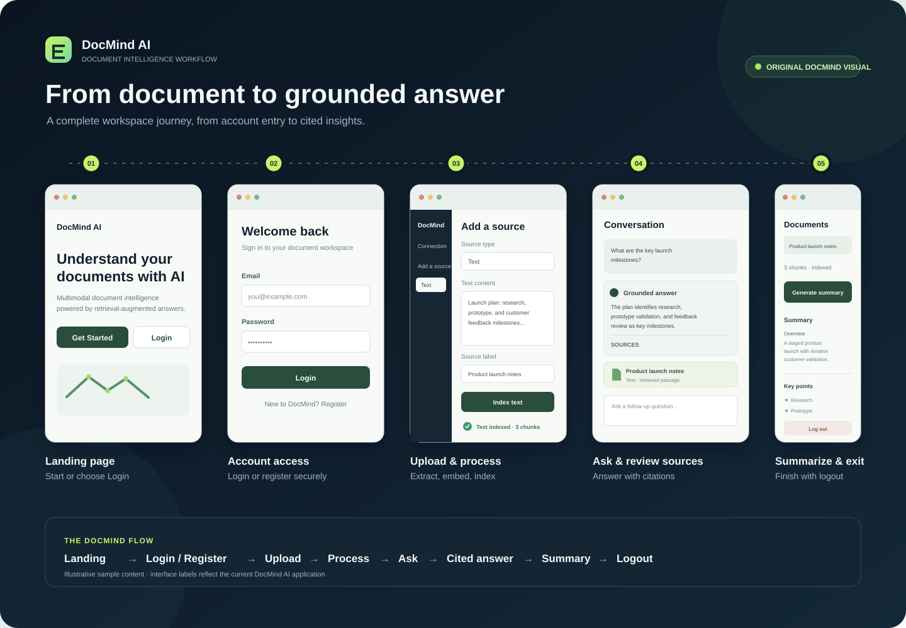
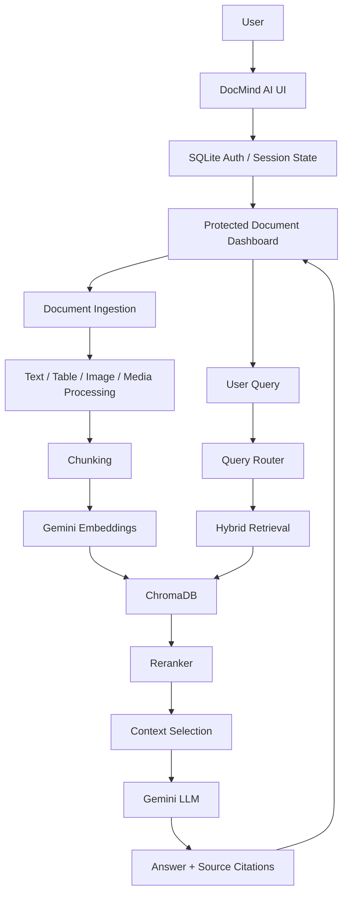

# DocMind AI

**AI-Powered Multimodal Document Intelligence & RAG Assistant**

DocMind AI is a portfolio-grade customization of the open-source [Multimodal RAG](https://github.com/vishakha-codes/multimodal_rag) reference project. It ingests text, URLs, PDFs, images, audio, and video into a shared vector index and answers questions with grounded citations—while passing original media back to Gemini at query time for truly multimodal reasoning.

## Demo



The workflow visual is an original DocMind AI illustration. Its sample document text is illustrative and is not a real user document or a captured model response.

## Problem statement

Knowledge is scattered across PDFs, web pages, slides, recordings, and images. Traditional chatbots cannot reliably ground answers in *your* documents. DocMind AI combines multimodal ingestion, hybrid retrieval, and citation-aware generation so users can upload sources once and ask natural-language questions with traceable answers.

## Features

- **Multimodal ingestion:** Text, URL, PDF, image, audio, and video in one pipeline
- **Hybrid retrieval:** Vector similarity (Gemini Embedding 2) + keyword overlap fusion
- **Optional reranking:** Modular reranker selects the most useful chunks before LLM context
- **Query routing:** Lightweight routing for QA, summarization, comparison, and general questions
- **Source citations:** Filename, type, and PDF page numbers when metadata exists
- **Document summaries:** Per-document “Generate summary” after indexing
- **Session chat:** Multi-turn conversation in the current browser session
- **Local account flow:** SQLite registration/login with salted PBKDF2 password hashes
- **Public landing page:** Feature overview, workflow, technology stack, and account entry points
- **Document insights:** Live counts for documents, pages, chunks, and queries
- **Answer feedback:** 👍 / 👎 stored for the current session only
- **Evaluation hooks:** Example dataset and CLI in `evaluation/evaluate_rag.py`
- **Persistent vectors:** Local ChromaDB under `data/chroma/` (gitignored)

## Screenshots

Add screenshots of the Streamlit UI here after running locally (`docs/screenshots/` optional).

## Architecture



## RAG pipeline

1. **Ingest** — Detect source type and extract content (PyPDF, HTTP fetch, Gemini File API for media).
2. **Chunk** — `RecursiveCharacterTextSplitter` with configurable size/overlap.
3. **Embed** — Gemini Embedding 2 per chunk.
4. **Store** — ChromaDB (persistent local path `data/chroma/`).
5. **Query** — Route intent → embed question → hybrid retrieve → rerank → build multimodal prompt.
6. **Generate** — Gemini 3 Flash with text context and original media URIs when retrieved.
7. **Cite** — Surface known metadata (label, type, page) in the UI.

## Multimodal processing

| Type | Processing |
|------|------------|
| Text | Direct chunking |
| URL | Fetch + HTML cleanup |
| PDF | LangChain `PyPDFLoader` (first 100 pages cap) |
| Image / audio / video | Gemini File API → description/transcript → index; file URI replayed at answer time |

## Technology stack

| Layer | Technology |
|-------|------------|
| UI | Streamlit |
| LLM | Gemini 3 Flash (`gemini-3-flash-preview`) |
| Embeddings | Gemini Embedding 2 (`gemini-embedding-2`) |
| Orchestration | LangChain document loaders & splitters |
| Vector DB | ChromaDB (persistent local) |
| Media | Google Gemini File API |
| Local authentication | Python `sqlite3` and PBKDF2-HMAC-SHA256 (`hashlib`) |

## Project structure

```text
multimodal_rag-main/
├── app.py                 # DocMind AI Streamlit UI
├── rag.py                 # MultimodalRAG orchestrator
├── config.py              # Constants and paths
├── services/
│   ├── auth.py            # Local SQLite accounts and password verification
│   ├── embeddings.py
│   ├── retrieval.py       # Hybrid search + reranker
│   ├── routing.py
│   ├── generation.py
│   └── summarization.py
├── evaluation/
│   └── evaluate_rag.py
├── data/
│   └── chroma/            # Created at runtime (gitignored)
│   └── docmind_users.sqlite3 # Created at runtime (gitignored)
├── assets/
│   └── docmind-workflow.svg # Original DocMind AI workflow illustration
├── pyproject.toml
├── .env.example           # Placeholder only; copy to .env locally
└── README.md
```

## Prerequisites

- Python 3.10+
- [uv](https://docs.astral.sh/uv/)
- Google API key from [Google AI Studio](https://aistudio.google.com)

## Installation

```bash
cd multimodal_rag-main
copy .env.example .env
# Edit .env and set GOOGLE_API_KEY
uv sync
```

On macOS/Linux, use `cp .env.example .env` instead of `copy`.

## Environment variables

| Variable | Description |
|----------|-------------|
| `GOOGLE_API_KEY` | Gemini LLM, embeddings, and File API |

Accounts are stored locally in `data/docmind_users.sqlite3`; only salted PBKDF2 password hashes are stored. Login state is held in Streamlit session state. The local account database is ignored by Git.

Never commit `.env` or real API keys.

## Running locally

```bash
uv run streamlit run app.py
```

Open `http://localhost:8501`.

## Usage

1. Register a local account or log in with an existing account.
2. Enter your API key (or use `.env`) in the authenticated dashboard.
3. Add documents from the sidebar (text, URL, PDF, image, audio, video).
4. Ask questions in the chat area—or use **Generate summary** on an indexed document.
5. Review **Sources** and **Retrieved context** under each answer.
6. Use **New conversation** to clear chat (documents remain indexed until reset), or log out to return to the landing page.

## RAG workflow (conceptual)

```text
Input → Source detection → Extraction → Chunking → Embedding → ChromaDB
Query → Router → Vector + keyword fusion → Rerank → LLM → Answer + citations
```

## Evaluation

Run the example evaluation CLI (requires `GOOGLE_API_KEY`):

```bash
uv run python evaluation/evaluate_rag.py
```

Metrics reported are **real** for the run: latency, retrieval hit (substring match on labels), citation hit, and answer length—no fabricated accuracy percentages.

## Limitations

- PDF page cap (100) for large files; not a full enterprise OCR pipeline
- Embeddings are per-chunk sequential calls (API latency)
- Conversations and 👍/👎 feedback are **session-only** unless you add persistence
- Authentication is a lightweight local portfolio/demo feature, not production-grade identity management. It has no password reset, email verification, rate limiting, account recovery, or multi-instance session architecture.
- The Chroma collection is shared by the local app instance and is not partitioned per account; this is not suitable for private multi-user deployments.
- URL ingestion depends on public, fetchable pages
- Model availability depends on Google API model names and quotas

## Future improvements

- Persistent chat and feedback storage
- Cross-encoder or LLM-based reranking
- Deduplication / content-hash caching to skip re-embedding
- Batch embedding where the API supports it
- Production identity provider, per-user document isolation, password recovery, and abuse protections

## Credits & attribution

This project is a **customized derivative** of the open-source **Multimodal RAG** reference implementation by [vishakha-codes](https://github.com/vishakha-codes/multimodal_rag). Core ideas—multimodal ingestion, Gemini File API replay, and Chroma-backed RAG—come from that work.

DocMind AI additions include branding, UI/UX, hybrid retrieval, query routing, reranking, summarization, citations UI, insights, feedback, evaluation scaffolding, and persistent Chroma storage.

The local landing, registration, login, and logout flow is an additional portfolio feature. This copy does not include an upstream `LICENSE` file; no license has been added or replaced. Preserve the upstream license and attribution requirements before redistribution.

If the upstream repository includes a LICENSE file, retain it alongside this project and comply with its terms.

## License

Follow the license of the upstream **Multimodal RAG** repository. If no license file is present in your copy, obtain licensing terms from the original author before redistribution.
