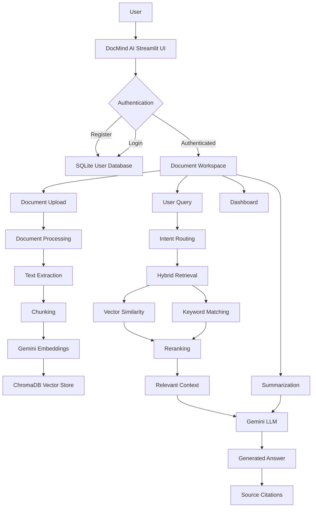
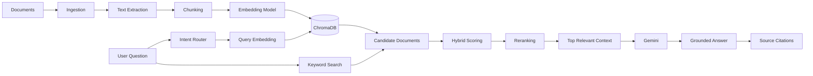

# 🧠 DocMind AI

## Multimodal Document Intelligence & RAG Assistant

DocMind AI is an AI-powered **multimodal document intelligence platform** that allows users to upload documents, retrieve relevant information, ask questions, and receive context-aware answers using **Retrieval-Augmented Generation (RAG)**.

The application combines document processing, text extraction, embeddings, vector search, hybrid retrieval, reranking, Gemini-powered generation, source citations, document summarization, analytics, and authentication into a single Streamlit application.

> **DocMind AI is a portfolio and educational GenAI project demonstrating how modern Retrieval-Augmented Generation systems can be designed, evaluated, and deployed using Python.**

---

## ✨ Features

### 📄 Multimodal Document Processing

- Upload and process supported documents.
- Extract text from documents.
- Split documents into searchable chunks.
- Store document representations for retrieval.
- Maintain source metadata for traceability.

### 🧠 Retrieval-Augmented Generation

DocMind AI follows a complete RAG pipeline:

1. Document ingestion
2. Text extraction
3. Document chunking
4. Embedding generation
5. Vector indexing
6. Query understanding
7. Hybrid retrieval
8. Relevance scoring
9. Reranking
10. Context construction
11. LLM answer generation
12. Source citation

This allows answers to be grounded in the user's uploaded content instead of relying only on the language model's internal knowledge.

### 🔎 Hybrid Retrieval

DocMind AI combines multiple retrieval signals:

- Vector similarity
- Keyword overlap
- Relevance scoring
- Reranking
- Route-specific retrieval depth

This improves retrieval quality for both semantic and exact keyword-based questions.

### 🤖 Gemini-Powered Generation

Google Gemini is used for:

- Context-aware question answering
- Multimodal document understanding
- Summarization
- Answer generation

The generation layer is separated from the core RAG pipeline to make the system easier to maintain and extend.

### 📝 Document Summarization

Generate structured summaries from indexed document content.

Summaries can help users quickly understand:

- Main topics
- Important information
- Key points
- Document context

### 📚 Source Citations

Generated answers can include source information so users can understand which retrieved document content contributed to an answer.

### 🔐 Authentication

DocMind AI includes a local authentication layer with:

- User registration
- Login
- Email validation
- Password hashing
- Authentication state
- Local SQLite account storage

Passwords are not stored as plain text.

### 📊 Dashboard

The application includes dashboard functionality for monitoring document and retrieval activity.

### 🧪 Automated Testing

The project contains automated tests covering:

- Authentication
- Configuration
- Dashboard functionality
- Gemini services
- Embeddings
- Retrieval
- RAG behavior

Current test status:

```text
44 passed
```

---

# 🏗️ System Architecture



---

# 🔄 RAG Pipeline



---

# 🧩 Project Components

| Component | Purpose |
|---|---|
| `app.py` | Streamlit application and UI |
| `rag.py` | Core RAG pipeline |
| `config.py` | Application configuration |
| `services/auth.py` | Authentication and user management |
| `services/embeddings.py` | Gemini embedding integration |
| `services/generation.py` | LLM answer generation |
| `services/gemini.py` | Gemini service utilities |
| `services/retrieval.py` | Retrieval and ranking |
| `services/routing.py` | Query intent routing |
| `services/summarization.py` | Document summarization |
| `services/dashboard.py` | Dashboard functionality |
| `evaluation/` | RAG evaluation utilities |
| `tests/` | Automated tests |
| `assets/` | Project assets and architecture graphics |
| `data/` | Local runtime data |

---

# 🛠️ Tech Stack

## Programming Language

- Python 3.10+
- Tested with Python 3.11

## Frontend / UI

- Streamlit

## AI / GenAI

- Google Gemini
- Google GenAI SDK
- Embeddings
- Retrieval-Augmented Generation

## RAG / NLP

- LangChain
- LangChain Core
- LangChain Community
- LangChain Text Splitters

## Vector Database

- ChromaDB

## Document Processing

- PyPDF
- BeautifulSoup4
- HTTPX

## Database

- SQLite for local authentication

## Environment Management

- `uv`
- `python-dotenv`

## Testing

- Pytest

---

# 📁 Project Structure

```text
DocMind-AI/
│
├── assets/
│   └── docmind-workflow.svg
│
├── data/
│   └── .gitkeep
│
├── evaluation/
│   └── evaluate_rag.py
│
├── services/
│   ├── __init__.py
│   ├── auth.py
│   ├── dashboard.py
│   ├── embeddings.py
│   ├── gemini.py
│   ├── generation.py
│   ├── retrieval.py
│   ├── routing.py
│   └── summarization.py
│
├── tests/
│   ├── test_auth.py
│   ├── test_config.py
│   ├── test_dashboard.py
│   ├── test_gemini_services.py
│   └── test_rag_offline.py
│
├── .env.example
├── .gitignore
├── app.py
├── config.py
├── pyproject.toml
├── rag.py
├── README.md
└── uv.lock
```

---

# ⚙️ Installation

## 1. Clone the repository

```bash
git clone https://github.com/Pravin-05/DocMind-AI.git
cd DocMind-AI
```

---

## 2. Install `uv`

If `uv` is not already installed:

### Windows PowerShell

```powershell
powershell -ExecutionPolicy ByPass -c "irm https://astral.sh/uv/install.ps1 | iex"
```

Restart your terminal after installation.

Verify:

```powershell
uv --version
```

---

## 3. Create the environment and install dependencies

The project includes `pyproject.toml` and `uv.lock`.

Run:

```bash
uv sync
```

This creates the project environment and installs the dependencies required by DocMind AI.

---

# 🔑 Environment Configuration

Create a local `.env` file from the provided example.

### Windows

```powershell
copy .env.example .env
```

Then open `.env`:

```powershell
notepad .env
```

Add your Google Gemini API key:

```env
GOOGLE_API_KEY=your_google_gemini_api_key
```

> ⚠️ **Never commit your real `.env` file or API key to GitHub.**

The repository's `.gitignore` is configured to exclude `.env` files and local runtime data.

---

# ▶️ Run DocMind AI

From the project root:

```bash
uv run streamlit run app.py
```

Streamlit will start the application locally.

Open the URL displayed in the terminal, normally:

```text
http://localhost:8501
```

---

# 🧪 Run Tests

Run the complete test suite:

```bash
uv run pytest
```

Expected result:

```text
44 passed
```

The tests cover the major application components without requiring a live Gemini API call for the offline test paths.

---

# 🔬 Test Coverage

The current test suite includes:

```text
tests/
├── test_auth.py
├── test_config.py
├── test_dashboard.py
├── test_gemini_services.py
└── test_rag_offline.py
```

Run a specific test file:

```bash
uv run pytest tests/test_auth.py
```

Run the RAG tests:

```bash
uv run pytest tests/test_rag_offline.py
```

Run tests with verbose output:

```bash
uv run pytest -v
```

---

# 🚀 Demo Workflow

A typical DocMind AI workflow is:

```text
1. Open DocMind AI
        ↓
2. Register / Login
        ↓
3. Upload a document
        ↓
4. Document is processed
        ↓
5. Text is extracted and chunked
        ↓
6. Embeddings are generated
        ↓
7. Chunks are stored in ChromaDB
        ↓
8. Ask a question
        ↓
9. Query is routed
        ↓
10. Relevant content is retrieved
        ↓
11. Results are ranked
        ↓
12. Gemini generates the answer
        ↓
13. Sources are displayed
```

---

# 💡 Example Questions

After uploading a document, users can ask questions such as:

```text
What are the main topics discussed in this document?
```

```text
Summarize the document.
```

```text
What are the key findings?
```

```text
What does the document say about the project objectives?
```

```text
Compare the important points across the uploaded sources.
```

The system retrieves relevant context before generating the final response.

---

# 🔐 Security Considerations

DocMind AI follows several basic security practices:

- API keys are loaded from environment variables.
- `.env` is excluded from Git.
- Local SQLite runtime data is excluded from Git.
- ChromaDB runtime storage is excluded from Git.
- Passwords are hashed rather than stored as plain text.
- Authentication is separated from the main application logic.

For production deployment, additional security controls should be implemented.

---

# 📦 Local Runtime Data

The following files/directories are intentionally not committed:

```text
.env
.venv/
data/chroma/
data/*.sqlite3
__pycache__/
.pytest_cache/
```

These contain local credentials, databases, caches, or generated vector-store data.

The repository keeps:

```text
data/.gitkeep
```

so the data directory remains represented in Git.

---

# 📊 Evaluation

The repository contains evaluation scaffolding under:

```text
evaluation/
```

The evaluation layer is intended to support experimentation with RAG quality and retrieval behavior.

Potential evaluation dimensions include:

- Retrieval relevance
- Context quality
- Answer grounding
- Citation quality
- Response accuracy
- Retrieval depth

---

# ⚠️ Current Limitations

DocMind AI is currently designed primarily as a **portfolio and educational GenAI application**.

Current limitations include:

- Local SQLite authentication is not intended for production-scale user management.
- ChromaDB is currently used as a local vector database.
- Gemini API access requires a valid API key.
- Retrieval quality depends on document structure and embedding quality.
- Very large documents may require additional optimization.
- Production deployment would require stronger authentication and authorization.
- Evaluation datasets and metrics can be expanded further.
- The application is currently optimized for local development and demonstration.

---

# 🔮 Future Enhancements

Potential future improvements include:

### 🤖 Advanced AI

- Multi-model LLM support
- Local LLM support
- Improved multimodal reasoning
- Vision-language document understanding
- Agentic RAG
- Query decomposition
- Self-reflective RAG
- Corrective RAG

### 🔎 Retrieval

- Hybrid BM25 + vector retrieval
- Advanced reranking models
- Metadata filtering
- Query expansion
- Multi-query retrieval
- Parent-document retrieval

### 📄 Document Intelligence

- DOCX support
- PPTX support
- Excel analysis
- Table extraction
- OCR
- Image understanding
- Scanned PDF processing

### ☁️ Deployment

- Docker
- Cloud deployment
- PostgreSQL
- Managed vector databases
- Object storage
- Production authentication
- API-based architecture

### 📊 Evaluation

- RAGAS integration
- Automated benchmark datasets
- Retrieval metrics
- Faithfulness evaluation
- Answer relevance scoring
- Hallucination detection

---

# 🧠 Why RAG?

Traditional LLM applications can generate impressive responses, but they may not have access to a user's private documents.

RAG solves this by retrieving relevant information from an external knowledge source before generating an answer.

```text
Traditional LLM

Question ───────────────► LLM ───────────────► Answer
                              │
                              └── Internal knowledge
```

DocMind AI instead uses:

```text
Question
   │
   ▼
Retriever
   │
   ▼
Relevant Document Context
   │
   ▼
Gemini
   │
   ▼
Grounded Answer + Sources
```

This allows the application to answer questions using information contained in the user's documents.

---

# 🏆 Portfolio Highlights

DocMind AI demonstrates practical implementation of several modern GenAI concepts:

- Retrieval-Augmented Generation
- Multimodal document processing
- Vector databases
- Embeddings
- Hybrid retrieval
- Reranking
- LLM integration
- Prompt engineering
- Document summarization
- Source attribution
- Authentication
- Automated testing
- Evaluation scaffolding
- Modular Python architecture

The project is structured to demonstrate not only an AI interface, but also the underlying engineering required to build a maintainable RAG application.

---

# 🧪 Development Commands

### Install dependencies

```bash
uv sync
```

### Run the application

```bash
